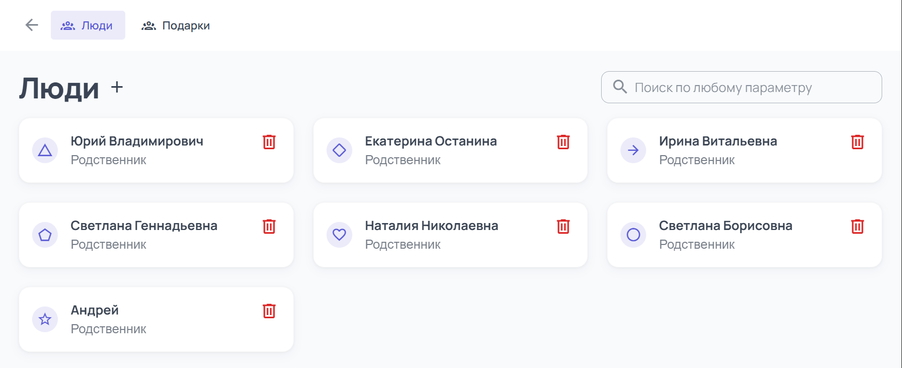
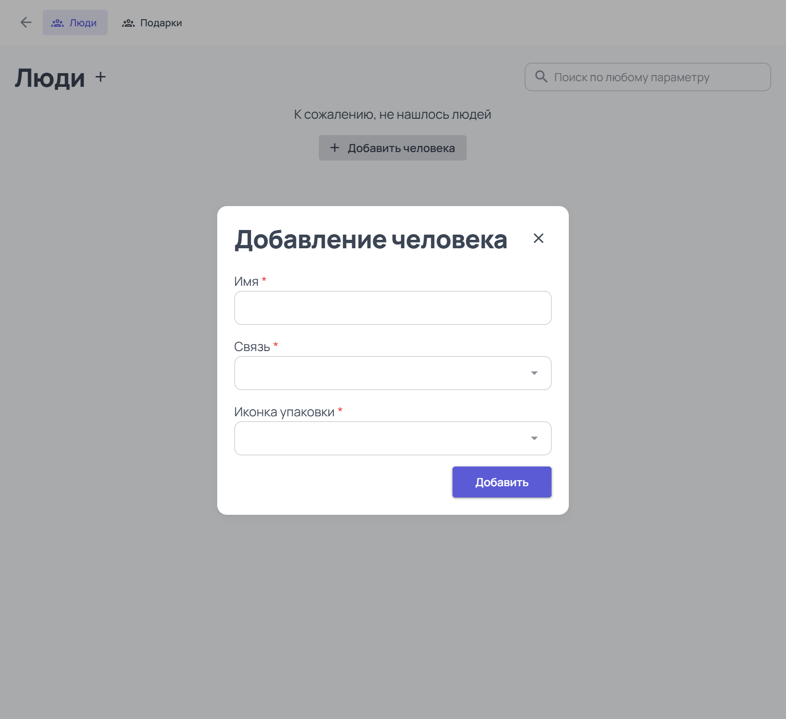
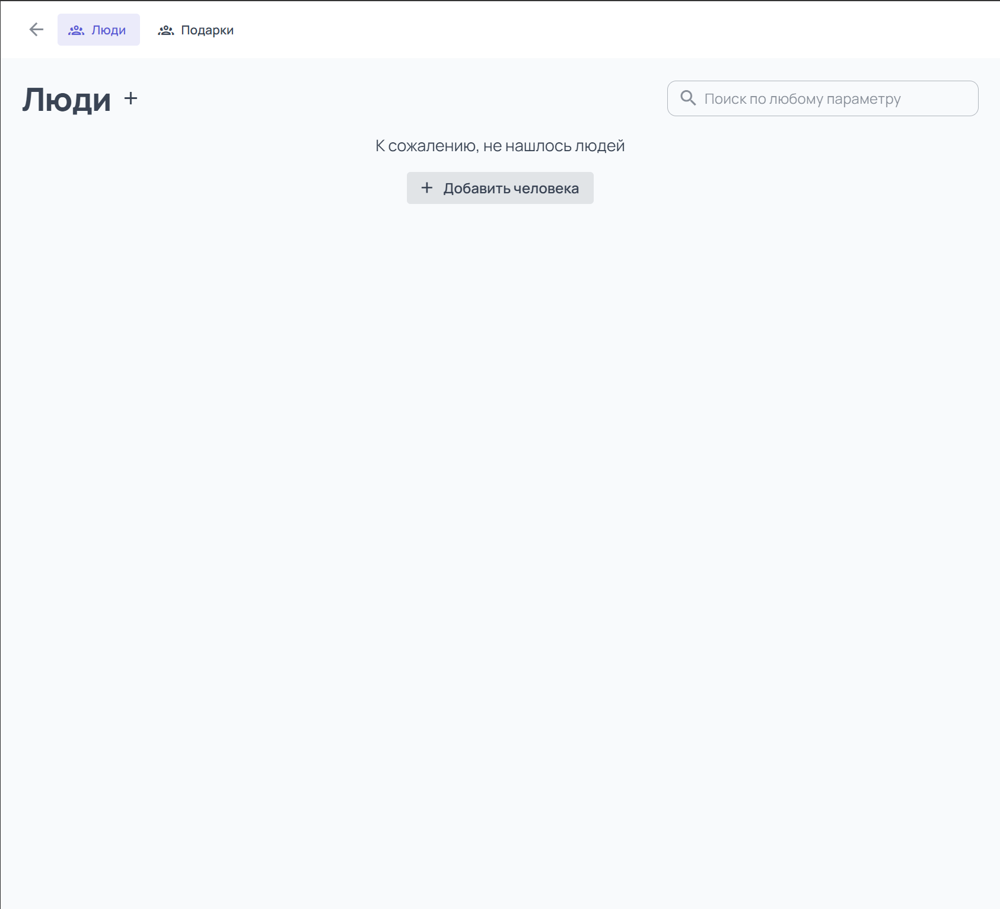
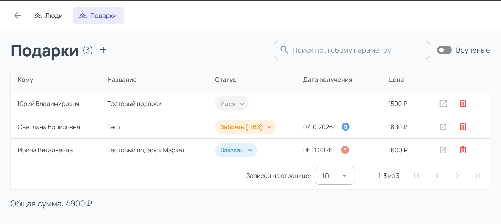
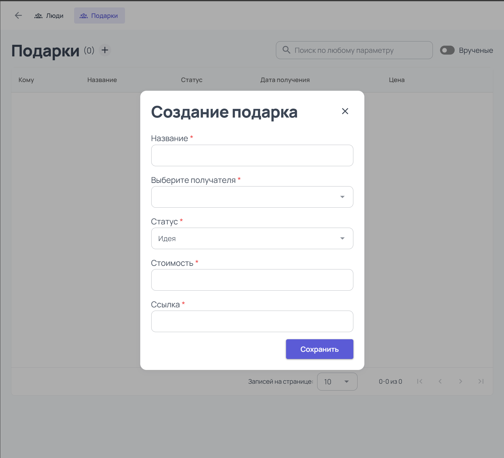
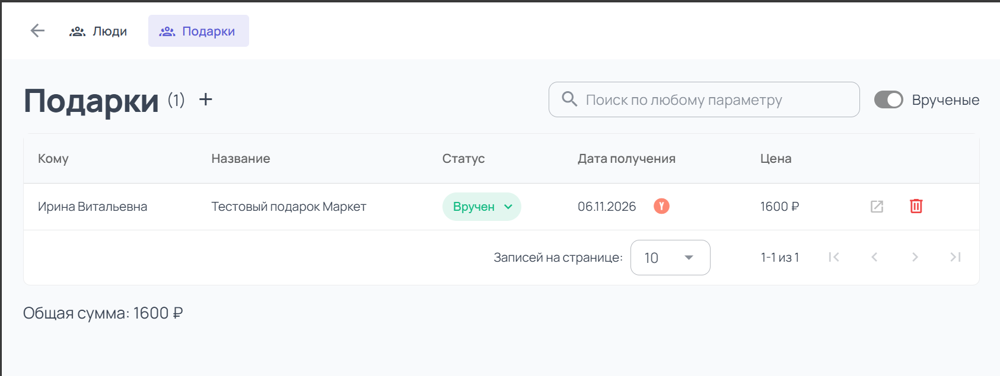
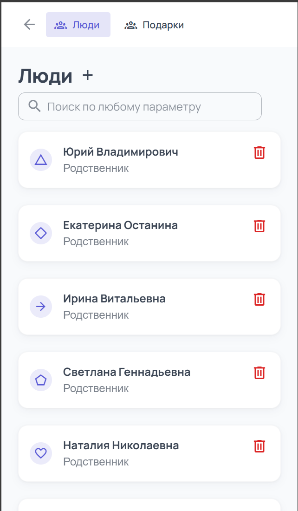
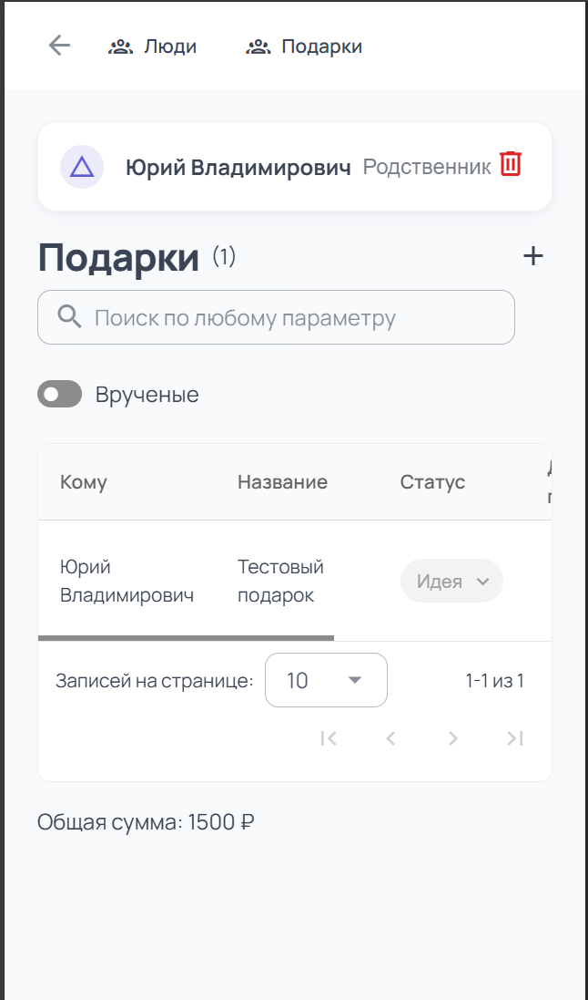
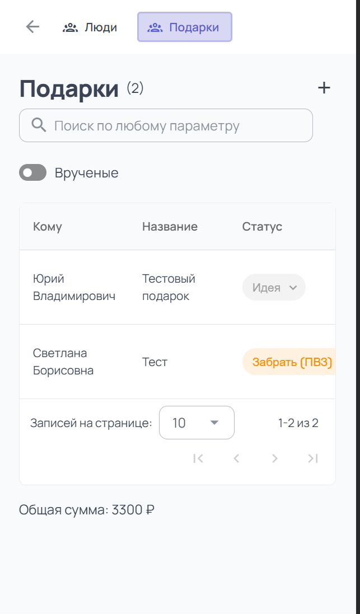

# 🎁 Gift Diary (Дневник подарков)

## О проекте

Я люблю все систематизировать и держать под контролем. Для меня это важно не только в рабочих задачах и коде, но и в
повседневной жизни. Каждый раз перед большими праздниками я сталкивалась с одной и той же проблемой: очень много
подарков, нужно ничего не забыть и никого не перепутать.

Чтобы получатели раньше времени не знали, что внутри, я решила подписывать подарки с помощью иконок.

История эволюции моего подхода к подаркам:

1. **Обычный лист А4** — варианты и списки писались от руки.
2. **Таблица Excel** — более структурированный подход.
3. **Gift Diary** — текущий проект, который автоматизирует весь процесс.

**Суть проекта** — помогать с подарками на большие праздники. Это приложение, которое позволяет регистрировать людей,
прикреплять к ним подарки и отслеживать их на разных стадиях готовности.

## 🚀 Функционал

### 1. Люди

Вы регистрируете человека и даете ему:

* Имя
* Родственную связь (родственник, друг, коллега)
* Иконку (для визуального различения и тайной подписи подарков)
  

В разделе Люди вы видите таблицу, в которой выводится вся информация о людях.

## 🗄️ Структура данных (Модель `People`)

Каждый человек в приложении описывается следующей структурой:

| Поле       | Тип              | Обязательное | Описание                                                                 |
|:-----------|:-----------------|:------------:|:-------------------------------------------------------------------------|
| `id`       | `string`         |      ✅       | Уникальный идентификатор (генерируется Firebase Firestore).              |
| `name`     | `string`         |      ✅       | Имя человека (например, «Мама», «Аня»).                                  |
| `relation` | `RelationPeople` |      ✅       | Кем приходится человек (Родственник, Друг, Коллега).                     |
| `icon`     | `string`         |      ❌       | Иконка упаковки (например, `mdi-gift`), чтобы тайно подписывать подарки. 

### 2. Таблица подарков

Вы составляете таблицу, где к каждому человеку прикрепляете конкретный подарок.

Создание подарка: 

Пользователь так же может посмотреть отдельно уже врученные подарки с полным функционалом таблицы.

## 🗄️ Структура данных (Модель `Gift`)

Каждый подарок в системе описывается следующей структурой:

| Поле         | Тип           | Обязательное | Описание                                                                             |
|:-------------|:--------------|:------------:|:-------------------------------------------------------------------------------------|
| `id`         | `string`      |      ✅       | Уникальный идентификатор (генерируется Firebase Firestore).                          |
| `personId`   | `string`      |      ✅       | ID человека из модели `People` (связь «Кому предназначен подарок»).                  |
| `title`      | `string`      |      ✅       | Название подарка (например, «Книга "Мастер и Маргарита"»).                           |
| `status`     | `GiftStatus`  |      ✅       | Текущий статус готовности (Идея, Заказан, В пути, Забрать, Упакован, Вручен и т.д.). |
| `price`      | `number`      |      ❌       | Стоимость подарка в рублях (опционально).                                            |
| `link`       | `ExternalUrl` |      ❌       | Внешняя ссылка на товар (Ozon, Wildberries, Яндекс Маркет). Строго валидируется.     |
| `datePickup` | `string`      |      ❌       | Планируемая или фактическая дата получения (в формате `YYYY-MM-DD`).                 |

### 3. Статусы готовности

Ключевая фича — отслеживание стадии готовности каждого подарка. Статусы помогают держать все под контролем и не забыть
забрать посылку вовремя. Цепочка выстроена от идеи до вручения:

**Планирование:**

* 💡 **Идея** — подарок придуман, но еще не утвержден.
* 👍 **Утвержден** — решение принято, подарок точно берем.

**Процесс покупки и доставки:**

* 📦 **Заказан** — заказ оформлен, ждем отправки.
* 🚚 **В пути** — посылка едет в пункт выдачи.

**Внимание (требует действия):**

* 🏃 **Забрать (ПВЗ)** — посылка пришла в пункт выдачи и ждет вас (важно не пропустить срок хранения!).

**Подготовка:**

* 🏠 **Дома** — подарок забран из ПВЗ и лежит дома.
* 🎀 **Упакован** — подарок красиво упакован и подписан.

**Завершение:**

* 🎁 **Вручен** — праздник прошел, подарок отдан получателю.

## 🛠 Стек технологий

Проект написан с использованием современных инструментов и лучших практик:

### ⚙️ Ядро приложения:

* **Vue 3** — прогрессивный фреймворк для создания пользовательских интерфейсов.
* **TypeScript** — строгая типизация для надежности кода.
* **Vite** — сверхбыстрый сборщик и сервер разработки.

### 🎨 UI и стилизация:

* **Vuetify 3** — библиотека компонентов в стиле Material Design.
* **MDI Font** (`@mdi/font`) — шрифт с иконками Material Design.

### 🗄️ Данные и состояние:

* **Pinia** — официальный стейт-менеджер для Vue 3.
* **Firebase** — облачная NoSQL база данных Firestore для синхронизации между устройствами.
* **Zod** — библиотека для декларативной валидации схем и типов.

### 🧭 Архитектура и навигация:

* **Vue Router** — официальный роутер для навигации между страницами.
* **Feature-Sliced Design (FSD)** — методология архитектуры проекта (слои `app`, `pages`, `widgets`, `features`,
  `entities`, `shared`).

### ✅ Качество кода и тестирование:

* **ESLint** — линтер для поиска и исправления проблем в коде.
* **eslint-plugin-vue** и **typescript-eslint** — правила для Vue и TypeScript.
* **eslint-plugin-vuejs-accessibility** — проверка доступности (a11y).
* **vue-tsc** — проверка типов в `.vue` файлах.

## 🤖 CI/CD (Непрерывная интеграция)

Для поддержания качества кода и предотвращения попадания ошибок в основную ветку в проекте настроен пайплайн GitHub
Actions.

При **открытии Pull Request** (или пуше в ветку `master`) автоматически запускается проверка, которая включает в себя:

* 📦 **Установку зависимостей** (с кэшированием для скорости).
* 🧹 **Проверку ESLint** (линтер блокирует PR, если есть некорректный код).
* 🔍 **Проверку типов** (`vue-tsc` гарантирует, что в TypeScript нет ошибок).

Если хотя бы один из шагов падает, Pull Request не может быть слит в основную ветку, пока ошибки не будут исправлены.

## 📱 Мобильная версия и адаптивность

Приложение имеет полностью корректную мобильную версию, удобную ровно столько же, сколько десктоп.

> 💡 **Совет:** Вы можете добавить приложение на главный экран смартфона (через меню браузера «Добавить на главный
> экран»). Благодаря настроенному `site.webmanifest` оно будет выглядеть как нативное приложение со своей иконкой и без
> адресной строки браузера.

## ⚠️ Статус проекта

Обратите внимание: данная система разрабатывалась **исключительно для личного использования** (для управления подарками
в кругу семьи и друзей). Проект не задумывался как коммерческий продукт или многопользовательская платформа (без сложной
системы авторизации и разграничения прав доступа).

Однако исходный код выложен на GitHub в качестве **пет-проекта (pet project)**. Здесь я оттачиваю навыки проектирования
архитектуры (Feature-Sliced Design), работы с современным стеком Vue 3 + TypeScript + Firebase, а также настройки CI/CD.
Вы можете свободно изучать код, брать идеи для своих проектов или форкать репозиторий.